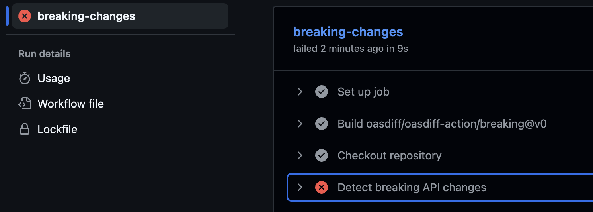
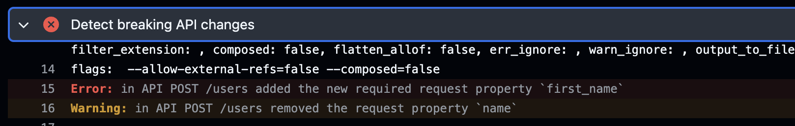
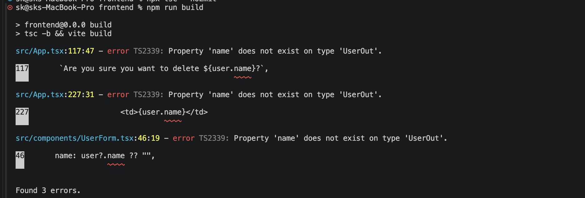

# Git Branch : react-hook-form
## Backend
### Create virtual environment
```
python -m venv .myvenv
```

### Activate virtual environment
```
source .myvenv/bin/activate
```

### Create requirements.txt:
```
fastapi
uvicorn[standard]
sqlalchemy
email-validator
```

### Install dependencies:
```
python -m pip install -r requirements.txt
```

### app/database.py
We'll use SQLAlchemy to communicate with SQLite. This keeps database operations separate from our API routes.

### app/models.py
This file defines the database table.

### app/schemas.py
This is the most important file for our OpenAPI workflow.

Pydantic models define what the API accepts and returns. FastAPI uses these models to generate its OpenAPI schema automatically.


Notice the separation:
- UserCreate: data the frontend must send when creating a user.
- UserUpdate: data the frontend must send when updating a user.
- UserOut: data the backend returns to the frontend.
The frontend should not need to invent these API types independently.


### Start the backend from the backend directory:
```
python -m uvicorn app.main:app --reload
```

### Open these URLs:
- Swagger UI — [test the API](http://localhost:8000/docs)
- [Raw OpenAPI JSON schema](http://localhost:8000/openapi.json)
Try creating a user in Swagger UI. For example:


## Frontend
### Create a new Vite (React) project 
```
npm create vite@latest
```

### Install the form dependencies:
```
npm install react-hook-form zod @hookform/resolvers
```
My current react vite version have some version conflict with @hookform/resolvers latest version so i used a specific version
```
npm install react-hook-form zod @hookform/resolvers@5.9.1
```

### Install client dependencies:
```
npm install @hey-api/client-fetch
npm install -D @hey-api/openapi-ts
```
We used installed above hey dpi dependencies, because we want to create client schema automatically using backend openapi

### Create openapi-ts.config.ts in the frontend directory:
```
import { defineConfig } from "@hey-api/openapi-ts";

export default defineConfig({
  input: "http://localhost:8000/openapi.json",
  output: {
    path: "src/api/generated",
  },
  plugins: ["@hey-api/typescript", "@hey-api/sdk"],
});
```

### Add a script to the scripts section of frontend/package.json:
```
"generate:api": "openapi-ts"
```
Keep the existing Vite scripts; just add this entry.

Now run:
```
npm run generate:api
```

The generator reads the live OpenAPI document and writes TypeScript files into src/api/generated. The SDK plugin generates API methods, while the TypeScript plugin generates the associated types.

Your generated output will include equivalents of:
- A listUsers API method.
- A createUser API method.
- An updateUser API method.
- A deleteUser API method.
- TypeScript types for request payloads and response models.

The exact generated filenames and exported symbols depend on the generator version and configuration. **Don't create or edit these files manually.** Inspect the generated exports after running the command.

### Update react code to use react hook form and client sdk
1. **Create** `src/components/UserForm.tsx`
2. **Replace** `src/App.tsx`
3. **Replace** `src/index.css`

### Run the application
```
cd backend
python -m uvicorn app.main:app --reload

cd frontend
npm run dev
```
Open the Vite URL, usually `http://localhost:5173`.

### How to verify the generated SDK is working

When you use the UI, the requests should be:

| UI action   | Generated function | HTTP request              |
| ----------- | ------------------ | ------------------------- |
| Load users  | `listUsers()`      | `GET /users`              |
| Create user | `createUser()`     | `POST /users`             |
| Edit user   | `updateUser()`     | `PUT /users/{user_id}`    |
| Delete user | `deleteUserApi()`  | `DELETE /users/{user_id}` |

One important detail: if TypeScript reports that an operation doesn't accept `path` or `body`, or that `response.data` doesn't exist, don't suppress the error. The generated `sdk.gen.ts` and `types.gen.ts` define the exact contract for your installed generator. Share the relevant generated function signature, and we can align the code precisely.

Production note: this is a solid learning implementation. Before deploying it, add authentication and authorization, avoid exposing internal server errors to users, and handle concurrent requests and duplicate submissions appropriately.

## Generate zod schema dynamically using backend OpenAPI contract.
You may notice, we are using Zod schema in frontend for frontend validation, see UserForm.tsx 
```
const userSchema = z.object({
  name: z.string().trim().min(2, "Name must contain at least 2 characters"),
  email: z.email("Enter a valid email address"),
  is_active: z.boolean(),
});

export type UserFormValues = z.infer<typeof userSchema>;
```
We can also generate this schema using backend openapi specification

Right now, we maintained these rules in two places:
- FastAPI/Pydantic: backend validation.
- React/Zod: manually written frontend validation.

Let's create a new branch `dynamic-zod-schema` and see.
# Git Branch : dynamic-zod-schema
1. Update openapi-ts.config.ts
Just add `zod` in plugins list.

2. Regenerate the client
Make sure FastAPI is running, then run this in your frontend directory:
```
npm run generate:api
```

The generated schema will likely be named zUserCreate, following the plugin's default naming convention. Confirm the actual name in your generated output before importing it.

3. Update UserForm.tsx
- remove userSchema and use zUserCreate in place of it

With generated schemas, you can derive the frontend's supported validation rules from the OpenAPI contract.

One caveat: OpenAPI can only convey rules it actually describes. For example, if your Pydantic model doesn't specify a minimum name length, the generated Zod schema won't invent one. Database uniqueness and business rules must still be enforced by FastAPI.

For see updated code, checkout to `dynamic-zod-schema` branch and start both fontend and backend.

**Important:** don't edit zod.gen.ts directly. It will be overwritten the next time you regenerate.


**generating frontend Zod schemas from your backend OpenAPI specification is a valid production approach.** However, I wouldn't automatically generate every frontend validation rule from the backend. For a production React + FastAPI application, I recommend a hybrid approach: share API-contract validation where appropriate, and keep UI-specific validation in the frontend.

# Git Branch : extend-backend-rules

## 1. Three approaches

**Approach A: Write Zod schemas manually**
React has its own Zod schemas, while FastAPI uses Pydantic schemas.
<span style="color: red;">Duplication risk</span>
Works well for small apps, but the same rules can drift between frontend and backend.

**Approach B: Generate Zod schemas from OpenAPI**
FastAPI defines the API contract; the generator creates frontend validation schemas.
<span style="color: green;">Good for contract consistency</span>
Reduces duplication for rules expressible in OpenAPI and makes schema changes easier to propagate.

**Approach C: Generated schemas + UI-specific validation**
Generate contract-level validation, then compose it with frontend-specific rules when necessary.
<span style="color: green;">My recommendation</span>
Keeps API consistency without forcing the backend to own every interaction or presentation rule.

## 2. What should come from the backend versus frontend?

Consider your user form.

| Validation rule                                              | Best source                                                     |
| ------------------------------------------------------------ | --------------------------------------------------------------- |
| Email must have a valid format                               | Backend contract, reused on frontend                            |
| Name has a minimum length                                    | Backend contract, reused on frontend                            |
| `is_active` must be a boolean                                | Backend contract, reused on frontend                            |
| Show a friendly message under an input                       | Frontend                                                        |
| Require a field only when a particular UI option is selected | Often frontend; enforce the business rule on the backend too    |
| Email must be unique in the database                         | Backend; frontend can display the returned conflict             |
| User is authorized to deactivate an account                  | Backend authorization                                           |
| Confirm password before submitting                           | Frontend interaction, with relevant server-side rules as needed |

The critical distinction is that frontend validation improves user experience; backend validation enforces correctness and security. A client can bypass every frontend check and send HTTP requests directly.

## 3. How I'd structure your production project

For your React + FastAPI application, I'd use this flow:

**FastAPI + Pydantic**

Authoritative API contract and server validation

**OpenAPI + code generation in CI**

Generate SDK, TypeScript types and supported Zod schemas

**React application**

Generated schemas + React Hook Form + UI-specific rules

API requests are still validated by FastAPI when they reach the server.

I'd add three production safeguards:

1. **Regenerate in CI:** regenerate the SDK and schemas when the OpenAPI contract changes, and fail CI if generated files are stale.
2. **Don't hand-edit generated files:** keep custom Zod refinements and UI logic in separate files.
3. **Test both sides:** test frontend validation and backend validation independently, including invalid requests that bypass the UI.

## 4. One important limitation

OpenAPI doesn't describe every possible validation rule. For example, a Pydantic custom validator involving multiple fields, database state, or external services may not translate into an equivalent Zod schema.

Also, your frontend and backend may have different needs. A registration form might require a confirmation checkbox, even though the backend's `UserCreate` request doesn't contain that checkbox. It would be inappropriate to force that UI-only field into the API model solely to generate validation.

For those cases, use a frontend-specific schema that builds on the generated schema where appropriate.

## My recommendation

For your project, keep FastAPI/Pydantic as the source of truth for API-level rules, generate the TypeScript SDK and Zod schemas, and layer frontend-only validation on top when necessary. That provides consistency without coupling every UI requirement to the backend.

One final consideration: if you later have multiple clients—React web, mobile, and partner APIs—OpenAPI becomes especially valuable as a shared contract. Each client can generate its own SDK and reuse compatible validation rules without depending on the others' UI implementation.

### Add more fontend validation on top of backend generated
- Create a frontend schema `src/schemas/user.schema.ts` that extends the generated schema
```
import { z } from "zod";
import { zUserCreate } from "../api/generated/zod.gen";

// Start with backend-generated validation.
export const userCreateFormSchema = zUserCreate.extend({
  // Frontend-only validation for a better user experience.
  name: z
    .string()
    .trim()
    .min(2, "Name must contain at least 2 characters")
    .refine(
      (value) => /[a-zA-Z]/.test(value),
      "Name must contain at least one letter",
    )
});

export type UserCreateFormValues = z.infer<typeof userCreateFormSchema>;
```

For a more conservative extension that preserves the generated field rules, use .safeExtend() if your installed Zod version supports it:
```
import { z } from "zod";
import { zUserCreate } from "../api/generated/zod.gen";

export const userCreateFormSchema = zUserCreate.safeExtend({
  name: zUserCreate.shape.name.refine(
    (value) => /[a-zA-Z]/.test(value),
    "Name must contain at least one letter",
  ),
});
export type UserCreateFormValues = z.infer<typeof userCreateFormSchema>;

```

- Use the extended schema in `UserForm.tsx`

## What happens when you regenerate?

| Action                                  | Result                                                           |
| --------------------------------------- | ---------------------------------------------------------------- |
| Change a Pydantic validation rule       | Update the generated Zod schema when you regenerate              |
| Add a field to the backend API contract | Generated schema and types can include it                        |
| Add a frontend-only validation rule     | Only `user.schema.ts` changes                                    |
| Run `npm run generate:api` again        | Generated files are refreshed; your custom schema remains intact |
| Submit invalid data directly to the API | FastAPI still validates it independently                         |

One important distinction: OpenAPI can only generate rules represented in the API contract. Custom Pydantic validators aren't necessarily represented in OpenAPI, so some backend validation logic may still need separate frontend rules if you want equivalent early feedback.


# Git branch : api-contract-drift-detection
API contract drift detection: if the backend changes an API in a way that breaks the frontend contract, CI should detect it before the change is merged or deployed.

For your FastAPI + React + TypeScript project, I recommend using three complementary checks:

1. OpenAPI breaking-change check — detects changes such as `name` becoming `first_name`.
2. Frontend type-check and build — detects frontend code that no longer matches regenerated API types.
3. Generated-file consistency check — ensures developers haven't changed the backend contract without regenerating the frontend API files.

These checks solve different problems, so using all three gives you stronger protection.

## 1. First, keep a versioned OpenAPI contract

Add a snapshot of the API specification to your repository, for example:

Generate `backend/openapi.json` from your FastAPI app and commit it. The exact command depends on your Python package's entry point; for example, if your FastAPI instance is `app` in `app/main.py`:
Also make sure you have virtual environment activated in backend folder before running command.

```
cd backend

python -c "import json; from app.main import app; print(json.dumps(app.openapi(), indent=2))" > openapi.json
```
Above command will create openapi.json file in backend folder as per current python code and rules

This file becomes the version-controlled contract baseline. When you intentionally change an endpoint or schema, regenerate it and review the changes.

## 2. Detect breaking API changes with `oasdiff`

The open-source tool oasdiff compares two OpenAPI specifications and identifies changes that may break existing clients.

Add a GitHub Actions workflow at `.github/workflows/api-contract.yml`:

```
name: API Contract

on:
  pull_request:
    branches: [master]

permissions:
  contents: read

jobs:
  breaking-changes:
    runs-on: ubuntu-latest

    steps:
      - name: Checkout repository
        uses: actions/checkout@v4
        with:
          fetch-depth: 0

      - name: Detect breaking API changes
        uses: oasdiff/oasdiff-action/breaking@v0
        with:
          base: "origin/${{ github.base_ref }}:backend/openapi.json"
          revision: "HEAD:backend/openapi.json"
          fail-on: WARN
          review: false

```
This compares the contract in the pull request with the contract on its target branch. If it finds a breaking change at the configured severity, the check fails. `review: false` disables uploading the comparison to the hosted review service.

## 3. What happens if `name` becomes `first_name`?

Suppose the original backend schema is:

```
class UserCreate(BaseModel):    
    name: str    
    email: EmailStr
```

A developer changes it to:

```
class UserCreate(BaseModel):    
    first_name: str    
    email: EmailStr
```

The expected workflow is:

1\. Developer changes FastAPI

The `name` property is removed and `first_name` is introduced.

2\. OpenAPI snapshot changes

The regenerated `backend/openapi.json` describes the new contract.

3\. Breaking-change check runs

CI flags removal of the old property if it is a breaking change under the contract comparison rules.

4\. Developer resolves the change

Either preserve backward compatibility or intentionally coordinate the API and frontend changes, with explicit review of the breaking change.

A critical detail: the backend developer must regenerate and commit the OpenAPI snapshot. Otherwise, the breaking-change check compares two unchanged files and cannot see the change in the Python code.

> [!NOTE]
> This is a regenerate and commit approach, so master branch already have a openapi.json snapshop, Now when a developer change anything he need to regenerate openapi again using above python command then commit it, now CI will compare openapi.json with master branch and it something break it will fail
>
> We can also automate this in CI. CI can generate the old contract from the base branch and the new contract from the pull request, then compare them. That removes the need to maintain a committed snapshot, but requires checking out and running both versions of the backend.
> **My recommendation:** start with a committed openapi.json because it's straightforward to review in pull requests. Automate the freshness check in CI, and use a local generation command to make updates easy.

### Let's see this in action
1. create a test branch
2. Update `backend/app/schemas.py` to change name to first_name
```
class UserCreate(BaseModel):
    first_name: str = Field(min_length=2, max_length=100)
```
3. Re-Generate `backend/openapi.json` 
```
cd backend

python -c "import json; from app.main import app; print(json.dumps(app.openapi(), indent=2))" > openapi.json
```
4. Commit changes and push test branch and create a Pull Request

Once you create pull request for master, Github action Ci get started and fail due to conflict in master openapi.json and test branch openapi.json




## Let's do check number 2. Frontend type-check and build

Your current change renames name to first_name. To test frontend type-checking:
1. Keep the backend change in your test branch.
2. make sure you are in test branch
3. Regenerate the frontend API files from the updated OpenAPI contract.
```
cd frontend
npm run generate:api
```
4. Do not update the React form that still references name.
5. Run these commands in frontend:
```
npx tsc --noEmit
npm run build
```
If your form uses generated types or schemas correctly, TypeScript should flag references that no longer match the generated contract. The build may also fail if those errors affect compilation.

Note that this only works when the affected frontend code actually depends on the generated types. A manually defined form schema can hide some contract drift.

When you run above `npm run build` command in frontend it will show errors
